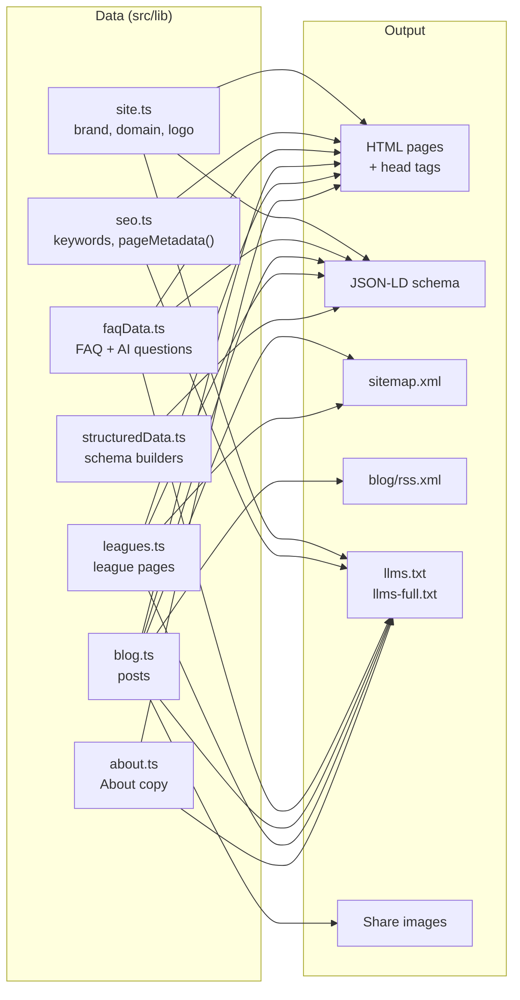

# SEO, AEO & GEO on statoz.in

This document explains how statoz.in is built so that Google, Bing and AI assistants (ChatGPT, Gemini, Claude, Perplexity) can find StatOz, understand it and name it. It covers what is implemented, where each piece lives in the code, how to keep it up to date, and what is still open.

| Layer | Goal | What does the work |
| --- | --- | --- |
| **SEO** (Search Engine Optimisation) | Rank in Google and Bing | Prerendered HTML, per-page head tags, keyword h1, league landing pages, sitemap, robots.txt, permanent redirects, IndexNow, structured data, deferred hero effect |
| **AEO** (Answer Engine Optimisation) | Be the direct answer in snippets, People Also Ask and voice results | Answer-first copy and FAQs on the homepage, FAQ page, every blog post and every league page, all with FAQPage schema |
| **GEO** (Generative Engine Optimisation) | Be cited and described correctly by AI chat assistants | llms.txt, llms-full.txt, AI crawler access, a stable PNG logo, per-post share images, consistent brand facts |

## Contents

1. [How it fits together](#how-it-fits-together)
2. [Where everything lives](#where-everything-lives)
3. [Page inventory](#page-inventory)
4. [SEO](#seo)
5. [Structured data](#structured-data-schemaorg-json-ld)
6. [AEO](#aeo)
7. [GEO](#geo)
8. [Content engine](#content-engine)
9. [Measurement](#measurement)
10. [How to…](#how-to)
11. [How to verify](#how-to-verify)
12. [Open issues](#open-issues)

---

## How it fits together

All SEO, AEO and GEO output is generated from a few data files. Pages, schema, sitemap, RSS, llms files and share images read the same source, so they rebuild on every deploy and can't contradict each other.



---

## Where everything lives

### Data and helpers

| File | What it holds |
| --- | --- |
| [src/lib/site.ts](../src/lib/site.ts) | Domain, brand names, description, language (`en-IN`), support email, logo and icon paths, shared Open Graph image |
| [src/lib/seo.ts](../src/lib/seo.ts) | Keyword groups (`KEYWORDS`) and the `pageMetadata()` helper that builds each page's head tags |
| [src/lib/structuredData.ts](../src/lib/structuredData.ts) | All schema.org JSON-LD: Organization, WebSite, MobileApplication, FAQPage, BreadcrumbList, Blog, BlogPosting; social profile list |
| [src/lib/faqData.ts](../src/lib/faqData.ts) | `FAQ_ITEMS` (homepage and /faq) and `AI_QUESTIONS` (written for AI assistants, printed in llms-full.txt) |
| [src/lib/blog.ts](../src/lib/blog.ts) | Every blog post as data: title, description, keywords, dates, body, FAQ, stats |
| [src/lib/leagues.ts](../src/lib/leagues.ts) | League landing pages as data (EPL, IPL) |
| [src/lib/about.ts](../src/lib/about.ts) | About page copy, shared by the page and llms-full.txt |
| [src/lib/llms.ts](../src/lib/llms.ts) | Builds llms.txt and llms-full.txt |
| [src/lib/storeLinks.ts](../src/lib/storeLinks.ts) | Google Play, App Store and web app (`https://web.statoz.in/`) links |
| [src/lib/analytics.ts](../src/lib/analytics.ts) | GA4 event names and the `trackEvent()` helper |

### Routes and generated files

| File | What it serves |
| --- | --- |
| [src/app/layout.tsx](../src/app/layout.tsx) | Root head tags, `lang="en-IN"`, Smart App Banner, verification tags, site-wide JSON-LD, analytics scripts |
| [src/app/robots.ts](../src/app/robots.ts) | `/robots.txt` |
| [src/app/sitemap.ts](../src/app/sitemap.ts) | `/sitemap.xml` |
| [src/app/manifest.ts](../src/app/manifest.ts) | `/manifest.webmanifest` |
| [src/app/llms.txt/route.ts](../src/app/llms.txt/route.ts) | `/llms.txt` |
| [src/app/llms-full.txt/route.ts](../src/app/llms-full.txt/route.ts) | `/llms-full.txt` |
| [src/app/blog/rss.xml/route.ts](../src/app/blog/rss.xml/route.ts) | `/blog/rss.xml` |
| [src/app/opengraph-image.tsx](../src/app/opengraph-image.tsx) | The site-wide 1200×630 share image (also used for X/Twitter) |
| [src/app/blog/[slug]/page.tsx](../src/app/blog/[slug]/page.tsx) | Every blog post |
| [src/app/blog/[slug]/opengraph-image.tsx](../src/app/blog/[slug]/opengraph-image.tsx) | Each post's own share image (also used for X/Twitter) |
| [src/app/predictions/[league]/page.tsx](../src/app/predictions/[league]/page.tsx) | Every league page |
| [src/app/not-found.tsx](../src/app/not-found.tsx) | Custom 404 page |
| [src/app/[section]/page.tsx](../src/app/[section]/page.tsx) | Short URLs (`/picks`, `/streaks`…) with permanent 308 redirects |
| [scripts/indexnow.mjs](../scripts/indexnow.mjs) | Submits the sitemap to IndexNow (`npm run indexnow`) |
| [public/5de3ca1f2d0479e180fb3af735db0780.txt](../public/5de3ca1f2d0479e180fb3af735db0780.txt) | IndexNow key file |

### Components

| File | What it does |
| --- | --- |
| [src/components/JsonLd.tsx](../src/components/JsonLd.tsx) | Writes a JSON-LD `<script>` safely |
| [src/components/Breadcrumbs.tsx](../src/components/Breadcrumbs.tsx) | Visible breadcrumbs plus BreadcrumbList schema |
| [src/components/Faq.tsx](../src/components/Faq.tsx) | Homepage FAQ plus FAQPage schema |
| [src/components/FaqList.tsx](../src/components/FaqList.tsx) | FAQ accordion plus FAQPage schema for posts and league pages |
| [src/components/ArticleView.tsx](../src/components/ArticleView.tsx) | Shared layout for blog posts and league pages |
| [src/components/DeferredPixelBlast.tsx](../src/components/DeferredPixelBlast.tsx) | Loads the hero's WebGL effect after the page is ready |
| [src/components/Hero.tsx](../src/components/Hero.tsx) | Homepage hero with the keyword h1 |
| [src/components/Footer.tsx](../src/components/Footer.tsx) | Brand blurb, social links, league links |
| [src/components/AnalyticsEvents.tsx](../src/components/AnalyticsEvents.tsx) | GA4 click, scroll and FAQ events |

---

## Page inventory

Every page also carries the site-wide Organization, WebSite, MobileApplication and WebApplication schema.

| URL | Rendering | Extra schema | FAQ | Sitemap | In llms files |
| --- | --- | --- | --- | --- | --- |
| `/` | Static | FAQPage | Yes (8) | Yes, priority 1.0 | Yes |
| `/predictions/epl`, `/predictions/ipl` | Static | FAQPage, BreadcrumbList | Yes (3) | Yes, 0.8 | Yes, in full |
| `/download` | Static | — | — | Yes, 0.8 | Yes |
| `/faq` | Server | FAQPage, BreadcrumbList | Yes (8) | Yes, 0.8 | Yes, in full |
| `/about` | Server | BreadcrumbList | — | Yes, 0.7 | Yes, in full |
| `/blog` | Static | Blog, BreadcrumbList | — | Yes, 0.7 | Yes |
| `/blog/[slug]` | Static | BlogPosting, FAQPage, BreadcrumbList | Yes (3–4) | Yes, 0.7, with lastmod | Yes, in full |
| `/termsAndConditions`, `/privacyPolicy` | Server | BreadcrumbList | — | Yes, 0.3 | Linked |
| `/[section]` (e.g. `/picks`) | 308 redirect | — | — | No | No |
| `/get` | Device redirect | — | — | No (blocked in robots.txt, noindex) | Via download.statoz.in |
| Any unknown URL | 404 page | — | — | No (noindex) | No |

"Server" pages render on each request because they read a `?layout=false` parameter for the in-app webview. They still deliver full HTML.

---

## SEO

### Rendering
Next.js prerenders these to static HTML at build time:

- homepage, Download, blog index;
- every blog post and its share image;
- every league page.

About, FAQ and the legal pages render on the server per request. Either way, crawlers that don't run JavaScript (most AI bots) get the full content.

### Per-page head tags
Every page builds its metadata through `pageMetadata()` in [seo.ts](../src/lib/seo.ts), which sets:

- title (with the `· StatOz` suffix, or an absolute title);
- meta description and keywords;
- canonical URL;
- Open Graph tags: type, title, description, URL, `en_IN` locale, a 1200×630 image (the post's own image on blog posts), and publish and modified times on articles;
- an X/Twitter `summary_large_image` card with its own title, description and image.

The root layout adds:

- robots `index, follow, max-image-preview:large, max-snippet:-1`;
- favicon and Apple touch icon;
- the RSS `<link rel="alternate">`;
- the Smart App Banner (`apple-itunes-app`);
- search engine verification tags, when configured.

### Homepage h1
The h1 reads "FREE SPORTS PREDICTION GAME · NO CASH · JUST SKILL — PREDICT EVERY MATCH. PROVE YOUR READ." The small kicker line sits inside the h1, so the page's main heading names what StatOz is.

`.hero__h1` uses `display: contents`, so both lines keep their exact original styles. On narrow widths (under 560px, and 901–1099px) the " · NO CASH · JUST SKILL" tail is hidden so the kicker stays on one line.

### League landing pages
`/predictions/epl` and `/predictions/ipl` target league searches ("Premier League prediction game", "IPL prediction game"). Each has:

- its own title, description and keywords;
- an answer-first intro;
- a FAQ with schema;
- links to related posts.

They are linked from the footer and the 404 page.

### Keywords
`KEYWORDS` in [seo.ts](../src/lib/seo.ts) groups the words fans type, including name variants (StatOz, Statoz, Stat Oz) and both "football" and "soccer":

| Group | Examples |
| --- | --- |
| Core | sports prediction game, free sports prediction game, match prediction quiz, football / soccer prediction game, prediction game India |
| Leagues | EPL predictions, Premier League prediction game, IPL prediction game, La Liga predictions, NBA predictions, cricket prediction game |
| FIFA World Cup 2026 | World Cup 2026 predictions, World Cup prediction app (kept for a future World Cup report; not used in page meta) |
| How the game works | Oz Coins, XP leaderboard, prediction streaks, prediction boosters |
| Free and not gambling | no real money, not gambling, not a betting app, no deposits, skill-based game |
| Audience | football fans, cricket fans, sports fans in India, fantasy sports players |
| Comparisons | free alternative to fantasy sports, prediction game vs fantasy sports |
| Brand | StatOz, Statoz, Stat Oz, StatOz app |

Each page picks the groups that fit it. The full list appears as "Topics" in llms-full.txt.

### Current-season copy
The site description, FAQ, AI answers, llms files, footer and share image lead with competitions that are on now: EPL, IPL, La Liga and NBA. The FIFA World Cup 2026 ended in July 2026 and is no longer presented as upcoming in these places.

### Language
`<html lang="en-IN">`, schema `inLanguage: "en-IN"` and Open Graph `en_IN` all tell search engines the site is for India.

### sitemap.xml
Lists 7 static pages, every league page and every blog post (11 URLs today). League pages and posts are added automatically from their data files. Posts carry their real `lastModified` date. Static pages have no date on purpose: stamping every URL with the build time teaches Google to ignore the field.

### robots.txt
Everything is allowed except `/get` (the device redirect behind download.statoz.in). Search engines, AI assistants and link-preview bots are also allowed by name, so a future blanket rule can't shut them out by accident (full list under [GEO](#ai-crawler-access)).

### Redirects
Short URLs such as `/picks`, `/leaderboard` and `/streaks` redirect to their homepage section with a **308 permanent** redirect, so search engines pass their signals to the target.

### 404 page
Unknown URLs return a real 404 status with `noindex`. The page uses the site's design ("This page is off the pitch") and links to home, the app download, league pages, FAQ, the blog and every post.

### IndexNow
IndexNow tells Bing, Yandex and other engines (and AI assistants that use Bing's index) about new or changed pages, so they recrawl sooner:

- the key file is served at `https://www.statoz.in/5de3ca1f2d0479e180fb3af735db0780.txt`;
- after a deploy, run `npm run indexnow` to submit every URL in the live sitemap.

### Search engine verification
Set these environment variables at build time to emit the verification meta tags. Skip them if the domain is verified by DNS.

- `GOOGLE_SITE_VERIFICATION` — the Search Console token;
- `BING_SITE_VERIFICATION` — the Bing Webmaster `msvalidate.01` token.

### Performance and resilience
- The hero effect is skipped entirely when the browser has no WebGL, and any error inside it is caught. Before this, a browser without WebGL (old devices, hardware acceleration off, some privacy browsers) crashed the whole homepage.
- The hero's WebGL dither effect (three.js + postprocessing) is split out of the initial JavaScript. It loads only after the page has fully loaded and the browser is idle, which keeps it out of the first paint (LCP) and early taps (INP). It sits at 16% opacity behind the copy, so the slightly later start isn't noticeable.
- GTM, GA4 and AdSense load after the page is interactive.
- Player art is WebP.

### RSS
`/blog/rss.xml` is an RSS 2.0 feed of every post, linked from every page's head.

### Manifest and icons
The favicon, Apple touch icon and manifest use `app-icon.png` (1200×1200). The manifest declares the real size and sets `lang`, `categories` and `purpose`.

### Smart App Banner
On iPhone and iPad Safari, Apple shows its native "Open in App Store" banner for StatOz (app id `6761310455`). Android and desktop are unaffected.

---

## Structured data (schema.org JSON-LD)

Entities reference each other by `@id`, so search engines and AI models resolve one StatOz, not several.

| Schema | Pages | What it says |
| --- | --- | --- |
| Organization | Every page | Name, alternate names, description, email, customer-support ContactPoint, `knowsAbout` topics, `sameAs` links (Instagram, YouTube, Reddit, LinkedIn, Google Play, App Store) |
| Logo (ImageObject) | Inside Organization | `statoz-logo.png`, 1200×1200 PNG, plus `app-icon.png` as `image` |
| WebSite | Every page | Name, alternate names, description, `en-IN` |
| MobileApplication | Every page | GameApplication on Android and iOS, free (₹0), 18+, install URLs, aggregate rating |
| WebApplication | Every page | The browser version at `https://web.statoz.in/`: GameApplication, any OS, free (₹0), browser requirements |
| FAQPage | Homepage, `/faq`, every blog post, every league page | The questions and answers shown on that page |
| BreadcrumbList | Every inner page | Emitted automatically by the `Breadcrumbs` component |
| Blog | `/blog` | The blog, with every post as a BlogPosting |
| BlogPosting | Every post | Headline, description, publish and modified dates, keywords, the post's own share image, author and publisher |

The logo is a PNG on purpose: not every crawler reads SVG or WebP.

---

## AEO

1. **Answer-first FAQ.** The 8 questions in `FAQ_ITEMS` name StatOz, and each answer opens with the direct answer ("Yes, StatOz is completely free…", "No. StatOz is a skill-based prediction game…"), so it still makes sense when lifted out alone.
2. **FAQs on every content page.** Each blog post (3–4 questions) and each league page (3 questions) ends with its own FAQ, written only from facts on that page, with FAQPage schema. Every page can win its own People Also Ask spots.
3. **Answer-first intros.** Every blog post and league page opens with the answer or the key numbers, then sets the scene.
4. **Questions people ask AI.** `AI_QUESTIONS` holds 12 Q&As phrased the way people ask assistants ("What is a free sports prediction app in India?", "Which prediction apps are not gambling?", "Can I play StatOz on a computer or in a browser?"). They are printed in llms-full.txt.
5. **Consistent facts.** Free, no real money, Android, iOS and web, four questions per match, answers locked at kickoff, XP for the quiz, Oz Coins for Picks: stated the same way across the pages, schema and llms files.

### Platforms
StatOz is on three platforms, and every source names all three:

| Platform | Link |
| --- | --- |
| Android | Google Play |
| iPhone and iPad | App Store |
| Any browser, desktop or mobile | Web app at `https://web.statoz.in/` |

The web app appears in:

- the homepage hero and the download section (on the homepage and `/download`): a "Play online · Web App" button beside the Google Play and App Store buttons. All three share one row on tablets and desktops; on phones the two store buttons share a row and Web App runs full width underneath;
- the WebApplication schema;
- the llms files (Key facts and "Download or play");
- the FAQ answers "What is StatOz?" and "How do I download StatOz?";
- the league FAQs;
- the AI answers;
- the Download page's meta description.

---

## GEO

### llms.txt — `/llms.txt`
A short Markdown guide ([llmstxt.org](https://llmstxt.org) format) containing:

- a one-line summary;
- what StatOz is;
- a **Brand** section: logo image, names, logo and icon URLs, social profiles, email;
- key facts, including all three platforms;
- "Download or play" links: Google Play, App Store, the web app and download.statoz.in;
- every page, league page and blog post with a one-line summary;
- a link to llms-full.txt.

### llms-full.txt — `/llms-full.txt`
The site's content in plain Markdown:

- Brand and key facts;
- **Questions people ask, answered** (the 12 `AI_QUESTIONS`);
- the full FAQ;
- every league page in full, with its FAQ;
- the full About page;
- every blog post in full, with its stats and FAQ;
- **Topics** (every keyword group);
- legal links.

### AI crawler access
robots.txt allows these by name:

- **OpenAI:** GPTBot, OAI-SearchBot, ChatGPT-User
- **Anthropic:** ClaudeBot, Claude-SearchBot, Claude-User
- **Perplexity:** PerplexityBot, Perplexity-User
- **Google Gemini:** Google-Extended
- **Apple:** Applebot, Applebot-Extended
- **Others:** Amazonbot, Meta-ExternalAgent, Meta-ExternalFetcher, MistralAI-User, DuckAssistBot, YouBot, cohere-ai, Bytespider, CCBot (Common Crawl)
- **Search:** Googlebot, Bingbot, DuckDuckBot, YandexBot
- **Link previews:** facebookexternalhit, Twitterbot, LinkedInBot, WhatsApp, TelegramBot, Slackbot, Discordbot

### A logo AI can show
The schema and both llms files point to one stable PNG: `https://www.statoz.in/assets/brand/statoz-logo.png`. **Don't move or rename it.**

### Share images
Every blog post has its own branded 1200×630 card showing its eyebrow, title and headline stat, in the post's colour (cyan for community reports, magenta for product guides). WhatsApp, LinkedIn and X show it when the link is shared, and the BlogPosting schema references it. Other pages use the site-wide card.

### Entity consistency
Names, description, email and social profiles come from [site.ts](../src/lib/site.ts) and [structuredData.ts](../src/lib/structuredData.ts). The schema, both llms files and the footer all use them, and the footer blurb uses the same "free sports prediction game" wording. Matching details across sources is how AI models confirm that StatOz, Statoz and the social pages are one company.

---

## Content engine

### Blog
Each post is one object in `BLOG_POSTS` in [blog.ts](../src/lib/blog.ts). One route, `/blog/[slug]`, renders all of them; unknown slugs return 404. Adding a post automatically adds it to:

- the blog index (`/blog`);
- sitemap.xml;
- the RSS feed;
- llms.txt and llms-full.txt;
- Blog, BlogPosting and FAQPage schema;
- its own share image;
- the "Read next" list on every other post (internal linking);
- the 404 page's link list.

Current posts:

- How the StatOz Prediction Quiz Works
- Our IPL 2026 Prediction Journey

### League pages
Each league is one object in `LEAGUE_PAGES` in [leagues.ts](../src/lib/leagues.ts), rendered by `/predictions/[league]`. Adding one automatically adds it to the sitemap, both llms files and the 404 page. Footer links are added by hand in [routes.ts](../src/lib/routes.ts).

Current pages: EPL, IPL.

### Writing style
Posts follow one pattern:

- an eyebrow such as `IPL 2026 · Community Report`;
- a Title Case title split for the gradient;
- an answer-first intro;
- 5–7 H2s that state the point ("292 players joined the action");
- one pull quote;
- a FAQ;
- a CTA and a stats sidebar.

The voice is "we" for community reports and "you" for guides. The vocabulary is fan language ("read the game", "back your call"), never betting terms. Numbers are exact, and every post restates that coins and XP have no cash value.

---

## Measurement

GA4 (`G-7KH0GEDEFX`) and Google Tag Manager (`GTM-T436Z2PL`) load after the page is interactive.

| Event | Fires when | Parameters |
| --- | --- | --- |
| `download_cta_click` | A store, web app or download button is clicked (header, hero, download section, footer Play Store icon, blog and league CTAs, 404 page) | `cta_label`, `cta_location`, `store` (`google_play`, `app_store`, `web_app`), `destination_url`, `page_path` |
| `section_view` | A homepage section scrolls into view (once per section) | `section_id`, `section_name`, `page_path` |
| `blog_post_click` | A post link is clicked (blog index, Read next) | `post_slug`, `post_title`, `destination_url`, `page_path` |
| `faq_open` | An FAQ question is opened | `question`, `faq_location` (`home`, `faq_page`, `blog_<slug>`, `league_<slug>`), `page_path` |
| `social_click` | A footer social icon is clicked | `network`, `location`, `link_url`, `page_path` |
| `email_click` | Any `mailto:` link is clicked | `email`, `page_path` |

`faq_open` shows which questions fans care about most. Use it to decide which answers to sharpen and which questions to add.

To track a new click, add `data-analytics-event="…"` and its `data-analytics-*` attributes to the element, and handle it in [AnalyticsEvents.tsx](../src/components/AnalyticsEvents.tsx).

---

## How to…

### Add a blog post
1. Add a route constant in [routes.ts](../src/lib/routes.ts), e.g. `myPost: "/blog/my-post"`.
2. Add a `BlogPost` object in [blog.ts](../src/lib/blog.ts) with:
   - `slug` and `href`;
   - `title`, `titleLead` and `titleGrad`;
   - `summary` and an answer-first `description` (under ~160 characters);
   - `keywords`;
   - `published` and `updated` (YYYY-MM-DD);
   - `visual`, `stats` and `statsPanel`;
   - `body`, `faq` and `cta`.
3. Put it at the top of `BLOG_POSTS` (newest first).
4. Open the post with the answer in the first sentence. Write FAQ answers only from facts in the post.

Everything else updates by itself, including the share image.

### Add a league page
1. Add a route constant in [routes.ts](../src/lib/routes.ts) and, if wanted, a footer link in `FOOTER_NAV_LINKS`.
2. Add a `LeaguePage` object in [leagues.ts](../src/lib/leagues.ts) and include it in `LEAGUE_PAGES`.

### Add or change an FAQ
- **Homepage and /faq:** edit `FAQ_ITEMS` in [faqData.ts](../src/lib/faqData.ts).
- **A post or league page:** edit its `faq` field.
- **AI answers in llms-full.txt:** edit `AI_QUESTIONS`.

Start each answer with the direct answer and name StatOz.

### Add any other page
1. Use `export const metadata = pageMetadata({ title, description, path, keywords })`.
2. Add it to `PAGES` in [sitemap.ts](../src/app/sitemap.ts).
3. Add it to the Pages list in [llms.ts](../src/lib/llms.ts).
4. Use the `Breadcrumbs` component for breadcrumb schema.

### Change a brand fact (name, email, description, social profile)
Change it in [site.ts](../src/lib/site.ts) or `SOCIAL_PROFILES` in [structuredData.ts](../src/lib/structuredData.ts). Also update the footer in [Footer.tsx](../src/components/Footer.tsx), which has its own social links.

### Add keywords
Add them to the right group in `KEYWORDS` in [seo.ts](../src/lib/seo.ts). They appear in llms-full.txt automatically. To use them in a page's meta, add them to that page's `keywords`.

### After every deploy
Run `npm run indexnow`.

---

## How to verify

Run locally:

```bash
npm run build && npx next start
```

Then open:

- `http://localhost:3000/robots.txt`
- `http://localhost:3000/sitemap.xml`
- `http://localhost:3000/llms.txt`
- `http://localhost:3000/llms-full.txt`
- `http://localhost:3000/blog/rss.xml`
- `http://localhost:3000/blog/ipl-2026-prediction-journey/opengraph-image`
- `http://localhost:3000/predictions/epl`
- `http://localhost:3000/picks` (should redirect with 308)
- `http://localhost:3000/any-missing-page` (should show the 404 page)

After deploying:

- test structured data with [Google Rich Results Test](https://search.google.com/test/rich-results) and the [Schema Markup Validator](https://validator.schema.org/);
- check share cards with LinkedIn Post Inspector, or by pasting a link into WhatsApp;
- measure Core Web Vitals with [PageSpeed Insights](https://pagespeed.web.dev/).

### Public URLs

| File | URL |
| --- | --- |
| llms.txt | https://www.statoz.in/llms.txt |
| llms-full.txt | https://www.statoz.in/llms-full.txt |
| robots.txt | https://www.statoz.in/robots.txt |
| sitemap.xml | https://www.statoz.in/sitemap.xml |
| RSS feed | https://www.statoz.in/blog/rss.xml |
| IndexNow key | https://www.statoz.in/5de3ca1f2d0479e180fb3af735db0780.txt |
| Logo (PNG) | https://www.statoz.in/assets/brand/statoz-logo.png |
| App icon | https://www.statoz.in/assets/brand/app-icon.png |

---

## Open issues

### Need a decision
- [ ] **Age rule conflicts.** The Terms say users can be 13+ (with parental consent under 18). The FAQ, footer ("18+ Only"), llms files and the schema's `contentRating` say 18+. Decide which is right and make every place match. AI assistants and app reviewers will see the conflict.
- [ ] **Prizes conflict.** The Terms describe giveaways with gift cards. The About page and FAQ say no real-money prizes can be won. Gift cards have real value, so reword one side.
- [ ] **App rating in schema.** MobileApplication claims a 4.8 rating from 5,000 ratings. The hero's "5K+ predictors playing" counts players, not ratings. Match it to the real store numbers or remove `aggregateRating`, or Google may issue a manual action.
- [ ] **World Cup sections on the homepage.** The Nations marquee ("48 NATIONS · WORLD CUP 2026") and the "World Cup 2026 — outright winner" Pick in [data.ts](../src/lib/data.ts) still present the finished tournament.
- [ ] **World Cup FAQ claim.** The "Which tournaments" answer says big tournaments like the FIFA World Cup get their own fixtures and quizzes. Confirm this is true for the app.
- [ ] **Desktop visitors to download.statoz.in.** `/get` sends any non-Apple device, including Windows and Linux desktops, to Google Play. Sending desktop browsers to the web app instead would convert better.
- [ ] **Responsible Play page.** The footer link points to the About page's "Not Gambling" section. A dedicated page (age rules, playing in moderation, support contact) would be better once the age rule is settled.

### Need facts
- [ ] **Blog publish dates.** Both posts use 3 Nov 2026 (marked TODO in [blog.ts](../src/lib/blog.ts)). Replace with the real dates.
- [ ] **Author names and bios** for posts, plus company details (founding year, founders, city, registered name) for the About page and Organization schema.
- [ ] **Extra profiles:** X/Twitter, Crunchbase or Wikidata, if they exist, to add to `sameAs`.

### Check
- [ ] **Canonical domain.** `SITE_URL` is `https://www.statoz.in`, but the About page links to `statoz.in`. Make sure one redirects to the other.
- [ ] **Possible GA4 double counting.** The layout loads gtag directly and also loads GTM. If GTM has its own GA4 tag for the same ID, page views count twice.
- [ ] **Dash style.** Blog copy uses a spaced hyphen (" -") where a dash belongs; the FAQ page uses "—". Normalise.
- [ ] **Performance.** Measure with PageSpeed Insights after deploy. Converting player art to `next/image` was skipped: the cards rely on CSS cropping and need a visual check first.

### Outside the code
- [ ] Verify the domain in Google Search Console and Bing Webmaster Tools (DNS or the env vars above) and submit the sitemap.
- [ ] Run `npm run indexnow` after each deploy.
- [ ] Mark `download_cta_click` as a key event in GA4.
- [ ] Publish 2–4 posts a month: a World Cup 2026 community report, prediction games vs fantasy sports, Oz Coins explained, monthly EPL season reports.
- [ ] Earn mentions and backlinks: football and cricket subreddits, LinkedIn, YouTube Shorts, app directories.
- [ ] Each month, ask ChatGPT, Gemini and Perplexity "free sports prediction game" and "sports prediction app no real money", and note whether StatOz is named.
